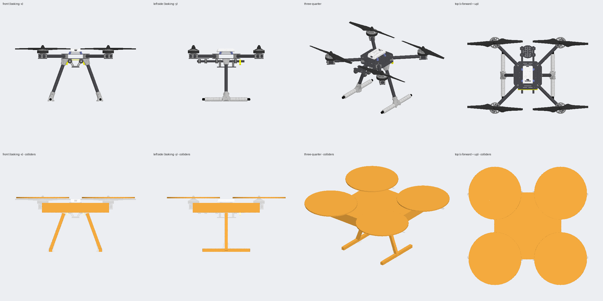
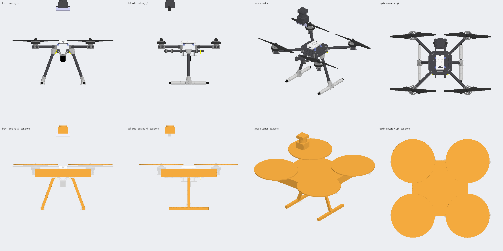

# Holybro X500 for Isaac Sim

A USD asset of the Holybro X500 quadrotor, converted from the PX4 Gazebo model
(`PX4/PX4-gazebo-models`, `models/x500` + `models/x500_base`).



**Status: loaded and checked against a real Isaac Sim 6.0.0** (headless,
2026-11-12) — it drops onto its skids under gravity and settles exactly
where the geometry says it should. See
[Before you rely on it](#before-you-rely-on-it) for exactly what that
covered and what's still open (Pegasus/PX4 specifically, RTX materials).

## Use it

The file to load is `x500/x500.usda`. It needs `geometries.usdc` and
`textures/` next to it, so copy or reference the whole `x500/` folder.

```python
# plain Isaac Sim
from isaacsim.core.utils.stage import add_reference_to_stage
add_reference_to_stage("/abs/path/to/x500/x500.usda", "/World/x500")
```

For PX4 SITL through Pegasus Simulator see `examples/pegasus_px4_x500.py`.

Spawn it at z ≥ 0.24 m: the origin is the body frame, the skids are 0.227 m
below it.

## What is in the asset

| Prim | What |
|---|---|
| `/x500` | default prim, articulation root |
| `/x500/body` | airframe rigid body, 2.0 kg, inertia (0.0217, 0.0217, 0.04) kg·m² |
| `/x500/rotor0` … `rotor3` | rotor rigid bodies, 16 g each, at (±0.174, ±0.174, 0.06) m |
| `/x500/joints/joint0` … `joint3` | continuous revolute joints about Z |
| `…/visuals/*` | instanced references into `geometries.usdc` (207 584 triangles in total) |
| `…/collisions/*` | 5 boxes on the body, one disc per rotor |

- Units are metres and kilograms, Z up. Body frame is x forward, y left, z up.
- Rotor numbering is PX4 quad-X: 0 front-right, 1 rear-left (both
  counter-clockwise), 2 front-left, 3 rear-right (both clockwise).
- Prim names (`body`, `rotorN`, `jointN`) are the ones Pegasus Simulator looks up.
- Each rotor prim carries the Gazebo motor-model numbers as `x500:motor:*`
  attributes (`motorConstant` 8.54858e-06, `momentConstant` 0.016,
  `maxRotVelocity` 1000 rad/s, …). Nothing in Isaac Sim reads them
  automatically; they are there so your controller code can.

### Where it differs from the PX4 model

- Rotor colliders are discs (radius 0.14 m, 5 mm thick) instead of the SDF's
  0.279 × 0.017 × 0.0008 m boxes, which are too thin for PhysX to handle well.
- Roughness and metalness are hand-picked; the source materials only define a
  colour.
- The Gazebo sensors (IMU, barometer, magnetometer, GPS) and the motor plugin
  are not part of the USD. Add them in your simulation code.
- No Isaac robot-schema overlay (`IsaacRobotAPI`), because it cannot be
  authored without Isaac Sim. Tools that need it can add it with
  `usd.schema.isaac.robot_schema.ApplyRobotAPI` (robot type `Aerial`).

## Sensor accessories

`sensors/` adds a downward rangefinder, a forward 270° planar lidar and a
forward RGB/depth camera, each as its own additive USD layer on top of this
vehicle (or combined, via `sensors/full_stack.usda`). See
[`sensors/README.md`](sensors/README.md) — it also covers a real
compatibility gap for PX4-in-the-loop testing: Pegasus Simulator's shipped
camera and lidar sensor classes target a pre-6.0 Isaac Sim API and are, in
the lidar's case, not even enabled in Pegasus's own package.



## Before you rely on it

Checked here, without Isaac Sim (`scripts/validate_x500.py`):

- one articulation root; every rotor connected to the body by a joint whose
  frames agree
- explicit mass and inertia on all five bodies, total 2.064 kg
- all references and textures resolve; every mesh has a material
- geometry placement, by eye, from `docs/preview.png`

**Confirmed against a live Isaac Sim 6.0.0** (headless, referenced into a
fresh stage the documented way below, with a ground plane added): falls
under gravity and settles at z = 0.2270 m starting from z = 1.0 m — the
documented 0.227 m skid offset, to the decimal — over 60 physics steps
with nothing diverging.

Still not checked — do this once, with a GUI:

1. Open `x500/x500.usda`, press Play: watch it land and stay still rather
   than just checking the final height numerically.
2. Look at the materials under RTX.
3. Run the Pegasus example and take off (PX4 MAVLink specifically is
   unconfirmed — see `sensors/README.md`'s compatibility notes, which
   apply to the base vehicle's flight loop too, just at lower risk).

## Rebuild

```bash
pip install -r requirements-build.txt
```

```bash
python scripts/build_x500.py
```

```bash
python scripts/validate_x500.py
```

```bash
python scripts/render_preview.py
```

`build_x500.py` downloads the PX4 meshes into `.cache/` and regenerates
`x500/`. Change numbers in the script, not in the generated `.usda`. Same
pattern for each sensor accessory: `python sensors/<name>/build.py`, then
`python scripts/validate_sensor_variant.py sensors/<name>/<name>.usda` —
see [`sensors/README.md`](sensors/README.md).

## Add it to a project

```bash
git submodule add https://github.com/Dronex-Delivery-Solutions/X500-USD.git assets/X500-USD
```

Then load `assets/X500-USD/x500/x500.usda`.

## License

BSD-3-Clause, see `LICENSE`. The meshes, textures and physical parameters come
from [PX4-gazebo-models](https://github.com/PX4/PX4-gazebo-models), Copyright
(c) 2022 PX4 Autopilot for Drones; the original notice is kept verbatim in
`LICENSE-PX4-gazebo-models`. Keep both files with the asset wherever you copy
or publish it.
